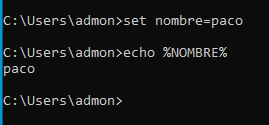
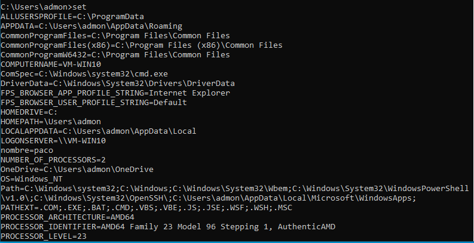

# Apuntes - Héctor Moreno

## Comandos Windows

### Eliminar una carpeta

`rmdir` -> Para eliminar una carpeta

`rmdir /s` -> para eliminar carpeta con contenido dentro

### Cambiar nombre a un archivo

`ren "archvio.txt" "nuevonombre.txt"`

### Listar todos los procesos activos

`tasklist`

### Para eliminar procesos

`taskkill`

`taskkill /f` -> para que no te pregunte si estás seguro de eliminar el proceso.

### Listar todos los servicios encendidos

`sc query`

### Ver contenido de un archivo

`type nombre_archivo.txt`

## Comandos de redes

### Mostrar la interfaz de red

`ipconfig`

`ipconfig /all` -> lo muestra todo más detallado.

### Comprobar la conectividad con otro equipo

`ping direccion_ip`

`ping nombre_de_dominio`

**Ejemplo**

`ping 192.168.1.20`

`ping www-jerez.es`

### Saber la dirección ip de un servidor de dominio

`nslookup nombre_de_dominio`

### Sitios por donde pasa la petición que se manda

`tracert www.jeres.es`

## Variables de entorno

`%USERNAME%` -> Usuario actual

`%COMPUTERNAME%` -> Nombre del equipo

`USERPROFILE` -> Carpeta personal

`%WINDIR%` -> Carpeta del sistema

`%PATH%` -> Ruta a los archivos ejecutables "importantes" a los que quiero acceder "rápidamente" desde la consola.

## Crear variables de entorno

### Para crear variables de entorno ponemos:

`set nombre=resultado`

**Ejemplo**



### Para eliminar la variable

`set nombre=`

### Listar todas las variables

`set`

**Ejemplo**



### Para añadir una ruta en el PATH

`set PATH=%PATH%;C:\Users\admon\Desktop\misprogramas`

Sólo en el CMD que esté ejecutandose. Si se cierra, se pierde lo que he añadido al PATH.

### Para que el cmd me pregunte

`set /p variable=texto_que_me_dice`


## Archivos bat (por lotes) o Script de Windows

Un archivo bat, es simplemente un archivo de texto con extensión bat que contiene una serie de comandos para que el cmd lo ejecute automáticamente uno detrás de otro.

## Condicionales con IF-ELSE

Un condicional permite ejecutar unas instrucciones cuando se cumple una condición.

### Ejemplo de condicional

```
@echo off

echo Quieres continuar? Contesta si o no

set /p respuesta=

if /i %respuesta%==si (
echo Has elegido continuar
) else (
echo Has elegido no continuar
)
pause
```

`/i` -> Esto hace que la comparación no distinga entre mayúscula y minúscula.

`set /p respuesta=` mostrar un mensaje en pantalla y pausar la ejecución del script para que el usuario escriba algo,

También se puede escribir de esta manera en vez de utilizar `echo`:

`set /p respuesta=Dime tu nombre:`

### Ejemplo condicional con números

**Comparación de si es igual:**

```
@echo off
echo Adivina el número:
set /p respuesta=

if %respuesta% EQU 4 (
echo Has acertado.
) else (
echo No has acertado.
)
pause
```

**Comparación de si un número es mayor que otro:**

```
@echo off
echo Dime tu edad:
set /p respuesta=

if %respuesta% GEQ 18 (
echo Eres mayor de edad
) else (
echo No eres mayor de edad
)
pause
```
**Comparación de si son iguales o son distintos (EQU)**

```
@echo off
echo Dime un numero:
set /p numeroA=

echo Ahora dime otro numero:
set /p numeroB=

if %numeroA% EQU %numeroB% (
echo El primer numero es igual del segundo.
) else (
echo El primero numero es distinto del segundo
)
pause
```
**Mayor o igual a (GEQ)**

```
@echo off
echo Dime un numero:
set /p numeroA=

echo Ahora dime otro numero:
set /p numeroB=

if %numeroA% GEQ %numeroB% (
echo El primer numero es mayor o igual del segundo.
) else (
echo El primero numero es menor que el segundo
)
pause
```
**Menor a (LSS)**

```
@echo off
echo Dime un numero:
set /p numeroA=

echo Ahora dime otro numero:
set /p numeroB=

if %numeroA% LSS %numeroB% (
echo El primer numero es menor que el segundo.
) else (
echo El primero numero no es menor que el segundo
)
pause
```

**Comprobación de existencia**

```
@echo off
if exist "Encuentrame\" (
echo La carpeta Encuentrame ya existe
) else (
mkdir "Encuentrame"
echo La carpeta Encuentrame no existe
)
pause
```

### Operadores


| Operadores (para las comparaciones) | Significado|
| ------------ | ------------ | 
| == | Igual (solo para texto porque se compara un número lo interpreta como un carácter, es decir, como un símbolo)|
| not%respuesta%==paco | Distinto |
| EQU | Igual a ("equal") |
| NEQ | Distinto a ("not equal") |
| LSS | Menor a ("less") |
| LEQ | Menor o igual ("less equal") |
| GTR | Mayor a |
| GEQ | Mayor o igual | 
| exists | Existe |

**Ejemplo operador "exists"**

- Comprobar que existe un archivo

```
@echo off
for %%x in (informa.txt inventario.txt usuarios.txt) do (
    if exist %%x (
        echo Existe el archivo %%x
    ) else (
        echo Falta el archivo %%x
    )
)
pause
```

## Bucles

### Bucle for

- **Bucle for**

- **Bucle for /L** -> Recorre lista de números 

### Bucle + condicional

- **Bucle IF**

- **Bucle IF ELSE**

## Comandos de gestión de usuarios en Windows con CMD

- Cuenta de usuario -> Identifica a un usuario o "servicio" ante el sistema.

- Autenticación -> Permite comprobar la identidad del usuario, por ejemplo, con contraseña.

- Autorización -> Determina qué permisos tiene el usuario.

- Grupo -> Sirve para adminsitrar conjuntamente los permisos de varias cuentas de usuario.

## Tipos de cuentas usuarios en Windows

Según sus privilegios:

- Cuenta estándar

- Cuenta Administrador

- Cuenta Invitado (está en desuso)

## Comandos Windows Usuario

- Ver todas las cuentas de usuarios:

`net user`

- Para ver quienes somos:

`whoami`

- Información concreta de la cuenta:

`net user $usuario`

- Para añadir un comentario (administrador):

`net user admon /comment:"Hola"`

- Para cambiar nombre completo:

`net user nombrecuenta /fullname:"nuevo_nombre"`

- Para activar una cuenta:

`net user nombrecuenta /active yes`

- Para desactivar una cuenta:

`net user nombrecuenta /active no`

- Para crear una cuenta:

`net user nombrecuenta /add`

- Para eliminar una cuenta:

`net user nombrecuenta /delete`

- Crear una cuenta con contraseña o ponerle la contraseña una vez ya creada:

`net user nombrecuenta *`

## Grupos de usuarios

Permiten agrupar usuarios y asignarles permisos a la vez.

- Para ver los grupos actuales:

`net localgroup`

- Ver información sobre un grupo:

`net localgroup nombregrupo`

- Crear un grupo:

`net localgroup nombregrupo /add`

- Meter un usuario a un grupo:

`net localgroup nombregrupo nombreusuario /add`

- Sacar un usuario de un grupo

`net localgroup nombregrupo nombreusuario /delete`

# Práctica 1 Soluciones

## Ejercicio 1

```bat
@echo off

echo Dime tu nombre:

set /p respuesta=

if /i %respuesta%==%USERNAME% (
	echo Hola, usuario del equipo
) else (
	eho El nombre no coincide con el usuario del equipo

pause
```

## Ejericio 2

```bat
@echo off

if exist "practica3/Ejercicio2_Practica3/" (
	echo La carpeta Ejercicio2_Practica3 ya existe
) else (
	mkdir "practica3/Ejercicio2_Practica3"
	echo La carpeta Ejercicio2_Practica3 se ha creado
)

pause
```

`mkdir` Ya crea las carpetas intermedias, si "practica3" no existiera, la crearía automáticamente.

## Ejercicio 3

```bat
@echo off

echo 1. Mostrar el nombre del usuario
echo 2. Mostrar la carpeta temporal
echo 3. Mostrar las rutas path

set /p respuesta=

if "%respuesta%"=="1" (
	echo Tu nombre de usuario es %USERNAME%
)
if "%respuesta%"=="2" (
    echo Esta es la carpeta temporal %TEMP%
)
if "%respuesta%"=="3" (
    echo Esta son las rutas del path: %PATH%
)

if "%respuesta%" NEQ "1" if "%respuesta%" NEQ "2" if "%respuesta%" NEQ "3" (
    echo Opción no válida
)

pause
```

## Ejercicio 4

```bat
@echo off
for %%i in (Equipo1, Equipo2, Equipo3, Equipo4, Equipo5) do (
	echo Creando la carpeta: %%i
	mkdir %%i
)

pause
```

## Ejericicio 7 - Corregirlo con gemini

```bat
@echo off

mkdir Entrada
mkdir Archivo

echo Archivo del equipo 1 > Entrada\equipo1.txt
echo Archivo del equipo 2 > Entrada\equipo2.txt
echo Archivo del equipo 3 > Entrada\equipo3.txt

mkdir Archivos

for /L %%x in (1,1,5) do (
    if %%x==1 (
        if exist Entrada\equipo1.txt (
            copy Entrada\equipo1.txt Archivo
        ) else (
            echo Aviso falta el archivo equipo1.txt
        )
        if %%x==2 (
            if exist Entrada\equipo2.txt (
            move Entrada\equipo2.txt Archivo
        ) else (
            echo Aviso falta el archivo equipo2.txt
        )
      ) else (
        if exist Entrada\equipo%%x.txt (
            echo El archivo equipo%%x.txt existe.

        ) else (
            echo Aviso falta 
        )
      )
    )
)


```


# Practica 2 Soluciones

## Ejercicio 2


```bat
@echo off

set /p respuesta=¿Desea preparar las cuentas del examen?(S/N)
if /i %respuesta%==S (
    for /L %%x in (1, 1, 3) do (
        echo Creando la cuenta aso_examen%%x
        net user aso_examen%%x * /add
        if %%x==1 (
            net user aso_examen%%x /comment:"Cuenta de prueba del profesor"
        ) else (
            net user aso_examen%%x /comment:"Cuenta de examen del alumnado"
        )
        net user aso_examen%%x >> C:\Users\admon\Desktop\cuentas_examen.txt
        echo SE HA CREADO LA CUENTA aso_examen%%x >> cuentas_examen.txt
    )

) else (
    echo Se ha cancelado la operación.
)

pause

```

## Ejercicio 3

```bat
@echo off

echo Creando grupos.
net localgroup ASO_Alumnos /add
net localgroup ASO_AlumnosPracticas /add
echo Grupos creados con éxito.
    
FOR /L %%x in (1,1,3) do (
    if %%x==1 (
        net localgroup ASO_Alumnos aso_examen%%x /add
    ) else (
        net localgroup ASO_AlumnosPracticas aso_examen%%x /add
    )
        
    if exist C:\Users\admon\Desktop\Informes_ASO (
           echo La carpeta ya existe.
    ) else (
        echo Creando carpeta Informes_ASO...
        mkdir C:\Users\admon\Desktop\Informes_ASO
        echo Carpeta Informes_ASO creada con exito
    )
        echo Creando archivos...
        net localgroup ASO_Alumnos > C:\Users\admon\Desktop\Informes_ASO\ASO_Alumnos.txt
        net localgroup ASO_AlumnosPracticas > C:\Users\admon\Desktop\Informes_ASO\ASO_AlumnosPracticas.txt
        echo Archivos creados correctamente.

        echo ============INFORMACIÓN MIEMBROS DEL GRUPO===========
        type C:\Users\admon\Desktop\Informes_ASO\ASO_Alumnos.txt
        type C:\Users\admon\Desktop\Informes_ASO\ASO_AlumnosPracticas.txt

    )
)

pause
```